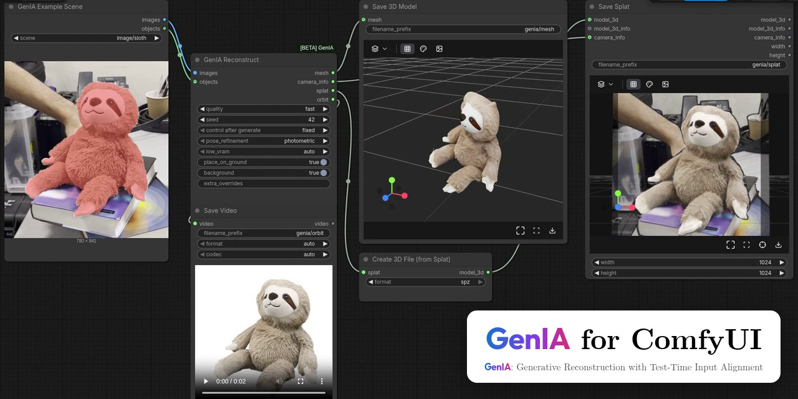

# ComfyUI-GenIA



[GenIA](https://facebookresearch.github.io/GenIA/) in ComfyUI: 3D reconstruction of the
objects in one photo, or in several photos of one static scene. What the photos see is
reconstructed; what they don't is generated.

[Project page](https://facebookresearch.github.io/GenIA/) ·
[Paper](https://arxiv.org/abs/2610.12388) · [GenIA code](https://github.com/facebookresearch/GenIA)

## Quick start

1. Install [GenIA](https://github.com/facebookresearch/GenIA) (`bash install.sh` in its
   checkout: Linux, an NVIDIA GPU with 24 GB or more, CUDA 12.8). The pack needs GenIA's
   demo (`demo/`), which comes with GenIA's next release.
2. Install ComfyUI into GenIA's environment: `pip install -r ComfyUI/requirements.txt`.
3. Clone this repo into `ComfyUI/custom_nodes/` and start ComfyUI from GenIA's environment.
4. Open a template: Templates → ComfyUI-GenIA → **GenIA - example image**, and run it.

## Nodes

**GenIA Reconstruct** (`3d/GenIA`)

| Input | |
|---|---|
| `images` | One photo, or the views of one static scene as a batch. Their cameras are estimated. |
| `objects` | Which objects: a MASK batch (one mask per object; for several views, each object's masks in view order, one object after another), or the output of ComfyUI's SAM3 Video Track run over the views. |
| `quality` | `fast` (default): FINETUNE 40 iterations. `full`: the paper's settings, 100. `draft`: no FINETUNE. |
| `seed` | 42 by default, as in GenIA's demo. |
| `pose_refinement` | `photometric` (default) or `icp`. |
| `low_vram` | `auto` (on below 44 GB of free GPU memory), `on`, `off`. On fits a 24 GB GPU. |
| `place_on_ground` | Rest the result on the ground plane (y = 0). |
| `background` | Add the rest of the photos to the splat. |
| `extra_overrides` | GenIA Hydra overrides, added last. |

| Output | |
|---|---|
| `mesh` | All objects, vertex-coloured. |
| `camera_info` | The input camera (for several views, the first). Save Splat seen from it shows the input view. |
| `splat` | All objects as Gaussian splats, and the background. |
| `orbit` | A turntable video. |

The node shows the run's progress (its step, object and time left), and ComfyUI's cancel
stops it. A run on inputs seen before resumes after the last step whose settings did not
change: changing `quality` re-runs only fine-tuning and what follows.

**GenIA Example Scene** (`3d/GenIA`): one of the scenes bundled with GenIA's demo, as
`images` and `objects` ready for GenIA Reconstruct.

## Templates

- **GenIA - example image**, **GenIA - example multi-view**: an example scene, reconstructed
  and saved (mesh, splat, turntable).
- **GenIA - your own photo (SAM3)**: Load Image → SAM3 Detect (name the objects) → GenIA.
- **GenIA - your own views (SAM3)**: Load Image per view → Batch Images → SAM3 Video Track →
  GenIA.

The SAM3 templates use ComfyUI's own SAM3 nodes; ComfyUI offers to download their checkpoint
(`sam3.1_multiplex_fp16.safetensors`). They open on photos from GenIA's demo, which the pack
copies into ComfyUI's `input/` when it loads (`genia_*.png`, never over an existing file).

## How it runs

GenIA's CUDA extensions are built against one torch, so the node runs GenIA one of two ways:

- **In ComfyUI's process** (recommended): ComfyUI runs in GenIA's environment. GenIA's models
  load on the first run (~25 s) and stay loaded; ComfyUI's own models are unloaded before
  each run to make room.
- **In a worker process**: ComfyUI keeps its own environment. Start it with
  `GENIA_ROOT=<GenIA checkout>` and `GENIA_PYTHON=<GenIA's env>/bin/python`; the node starts
  GenIA in a process of its own, whose models stay loaded between runs.

Either way a run is the GenIA demo's own recipe (`demo/method.py`), so it gives the demo's
results. Tested with ComfyUI v0.46.2 on an RTX 4090 (24 GB). GenIA's log goes to ComfyUI's
console (`--verbose DEBUG` for all of it).

Tests (CPU, ComfyUI importable): `PYTHONPATH=/path/to/ComfyUI pytest -v`

## License

This pack: **GNU GPL v3.0** (`LICENSE`). GenIA is not part of it (the node loads your GenIA
checkout) and has its own license, **CC BY-NC 4.0** (non-commercial), which governs GenIA's
code, weights and outputs.

The node design (one reconstruct node: images and masks in, a mesh and a camera out) is
inspired by [ComfyUI-Cupid3D](https://github.com/Nekodificador/ComfyUI-Cupid3D); no code is
shared.

## Citation

```bibtex
@article{esposito2026genia,
  title   = {GenIA: Generative Reconstruction with Test-Time Input Alignment},
  author  = {Esposito, Stefano and Pearl, Naama and Karpikova, Polina and
             Rota Bul{\`o}, Samuel and Porzi, Lorenzo and Kontschieder, Peter and
             Geiger, Andreas and Luiten, Jonathon},
  journal = {arXiv preprint arXiv:2610.12388},
  year    = {2026}
}
```
